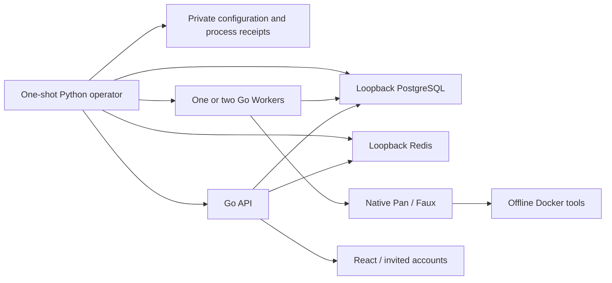

# #114 single-host deployment assembly

Criteria1.0 builds on accepted `effbf27db194d95a83238b665a00e7ef0da33d0f`; [contract](https://github.com/pym96/Pan-agent/issues/114#issuecomment-6103780997). This is a Builder candidate, not an accepted fact.

The [operator](../../../apps/evidence-web/deploy/README.md) installs a manifest-bound program directory and initializes a separate private data directory. Program = Go entry + built React + executor + unchanged Pan + Redis + original migration bytes + fixed report. PG, Node, Python and Docker are explicitly declared host dependencies. Init pins executable hashes. There is no source checkout or old WorkOrder runner in the runtime import graph.

The operator is assembly, not a replacement scheduler or task authority. It does not mutate task lifecycle SQL; SQL reads establish readiness/cleanup. Existing `tasks` transactions, fencing, maintenance, checkpoints and resume remain unchanged. Every service runs detached from the short-lived operation process. A file lock serializes lifecycle commands. Repeated healthy start keeps the same PIDs; unknown/partial state blocks a conflicting start. Process receipts combine PID/start time/command; Redis's exact known loopback title is allowed. Stop keeps API/PG running until task cleanup is observed, verifies actual container absence, then shuts down dependencies. Exceptions produce nonzero exit without deleting evidence or asserting success.

The standalone resource adapter preserves the accepted allocation formula, mandatory historical roots, inode deduplication, original Docker baseline and strict thresholds. Program/data roots and #114 external archives are additionally counted. OS account home locates the fixed host ledger even when child HOME is sanitized. It only samples/stat-checks old roots; it neither loads a benchmark runner nor mutates old evidence. Tests cover overlapping roots, hardlinks, symlink aliases and exact boundary/unknown rejection. This is host protection, not new task policy.

A stopped physical backup includes PG, private input/checkpoint/receipt/archive/task files, config and empty process receipts at one quiescent point. Redis is discardable. Restore verifies all hashes and requires the same host, PG major version, dependencies, exact program/data paths, absent destination and no owned running resources. Old data is renamed and retained, not deleted. No arbitrary RAM/PID recovery or cross-path checkpoint portability is claimed.

A dedicated test deployment explicitly permits known fault keys. Normal mode rejects injected config and inherited fault variables. The real browser journey labels Faux, shows actual computed output/source links and records chapters against task IDs and artifact hashes. Videos/credentials/raw traces are private; only safe navigation, code, and hashes are committed. See [evidence](../../evidence/web114/README.md) and [development failures](../../evidence/web114/development-notes.md).
