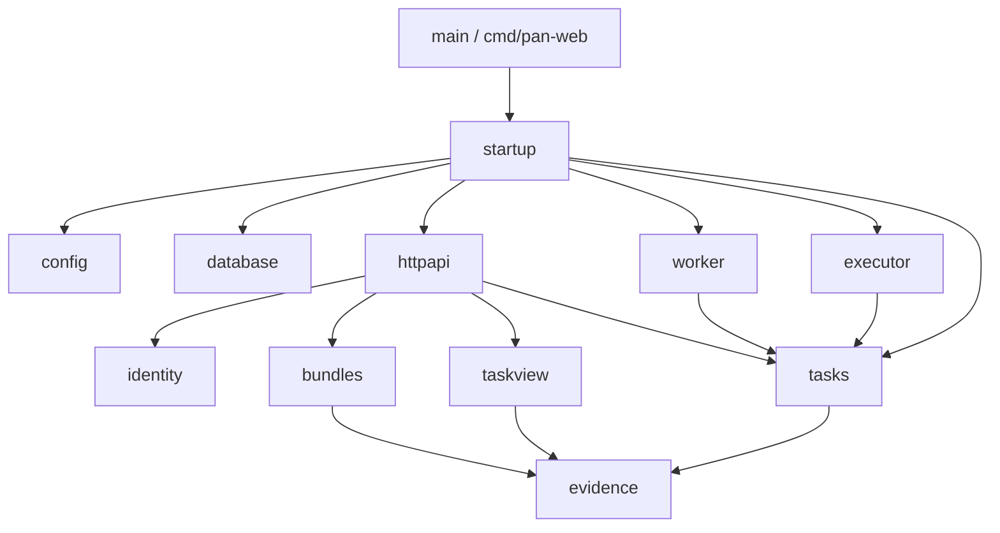

# #119 — Go packages and independent lifecycle maintenance

Product refactor from `5bdfc4d5a87a6b9431cb94d34f2c0db4de180949`; Criteria1.0. Builder proposal, pending independent Regulator. The deployed/archived #106–113 runners and evidence are unchanged.

## Ownership and dependencies

`querylog` carries only SQL observations in context; `result` carries typed domain outcomes/file bytes. Only httpapi translates those outcomes into HTTP status codes. Both are small shared data modules, not state owners. `config` is also consumed by HTTP, executor and worker. The full compiled import graph and `go doc` interfaces are in Builder evidence `structure.json`.

| Module | Public operations | Hidden invariants / dependencies |
|---|---|---|
| evidence | ParseBundle, PointerValue, Hash, ValidHash, ValidName; summary types | Strict JSON, source hashes/pointers, classification/unknown accounting; standard library only, no HTTP/PG/Redis/Docker |
| identity | Owner, Login, Logout, Invite | Session hash/expiry and password storage; no task controls |
| bundles | Import | Atomic bundle + exact uploaded files; no execution |
| taskview | task/list/history/bundle/file projections, Allowed | Only Query/QueryRow capability, no Exec/Begin/control/Node; account filtering and public checkpoint accounting |
| httpapi | New returns http.Handler | Routes, cookies, origin/body limits, JSON/error/download mapping, bounded read cache and successful-POST invalidation; no database handle or lifecycle SQL; read routes/cache use a separate receiver with only session lookup and projections |
| tasks | conversation commands, Control, Resume; OpenSession; Load, Start, Admit, Event, Checkpoint, Publish, Finish, Maintain | Private PG pool and transaction boundaries. Conversation order, task row authority, owner leases/backend identity, checkpoint receipt transitions, stop confirmation and idempotency belong here. No generic SQL executor exported |
| executor | Runner.Execute; Process.Stop/Reconcile | Node streams/ACKs, private files, exact PID/container identity, Docker cleanup, archive sealing and bounded operation reconciliation. No PG access |
| worker | Run; Coordinator.Run/Cycle | Scheduling, heartbeat cancellation, bounded periodic lifecycle maintenance. Calls task operations; does not implement SQL/Node protocol |
| database | Migrate | Same SQL bytes, sorted embedded names, same SHA ledger and advisory locks |
| config | Parse | Single environment parse at startup, typed values injected into constructors; no runtime package reads environment |

The root `main.go` is a short compatibility entry to the same startup wiring as `cmd/pan-web`; it contains no business implementation. `internal/startup` only assembles dependencies, migrates, and supervises the server/worker. Test-only fixture helpers are never imported by the binary.

## Explicit execution authority

Every admission, checkpoint/receipt, event and result operation takes `tasks.Authority{Task, Attempt, Owner, Generation}` explicitly. Empty/malformed IDs and nonpositive generations fail; well-formed foreign/stale identities fail under the same locked task row and live owner/backend checks. A missing context value can no longer authorize anything. Context is limited to deadlines, cancellation and SQL observations.

`Start` holds that row lock across the executor callback creating the Node child and registering its PID. No job reaches stdin before commit; failed registration kills/waits for the child. `Load` validates authority before creating any executor directory. `Checkpoint` derives task and attempt from the checked authority rather than accepting a second independent target. The SQL helper is private to tasks. Constructors receive trusted dependencies; HTTP callers never receive PG transactions or arbitrary SQL capabilities.

Cancel/replace/resume still lock the conversation and task in the original order. Publication and revocation retain the task-row arbitration. Stop and reconciliation remain inside those transactions: external operations may hold a connection/lock for seconds (reconciliation 15s, maintenance cycle 30s), delaying competing controls. Moving them outside the lock is deliberately not part of this refactor.

## Query / maintenance separation

Task list/detail/history and cache hit/miss/off do not revoke owners or write lifecycle state. PG authentication and ownership checks still happen before cache lookup. The 5s snapshot bound, 100ms Redis deadline, 2s PG projection deadline, four slots, bounded invalidation index and complete-JSON validation remain unchanged.

API supervision and Workers each run the same coordinator independently of HTTP reads. `Cycle(ctx)` is an explicit completion barrier; `Run` runs a bounded cycle then waits the configured interval, logging failures. Default interval 1s; accepted values are strictly positive durations <=1 minute. This is not a wall-clock SLO. Multiple coordinators use the existing recovery advisory lock and per-task locks; lease expiry remains no proof of stop. A cycle may revoke an owner yet return an error because stop is unknown. Retry does not refresh that owner's authority. API startup scripts supply the same pinned execution configuration as the Worker. Missing stop runtime fails closed.

Test scheduling uses an explicit released/completed cycle for no-query detection and a trusted `stop-unconfirmed` marker for real live-child fault boundaries. That marker blocks stopping before Node kill, so a test can observe an actually live old Node/container after revocation. It is operator fixture state, never supplied via HTTP/model input. Resource labels select only the instance to stop.

## Configuration and compatibility

| Earlier selector / entry | Current behavior |
|---|---|
| `WEB_ISSUE=web107…web113` capability selection | Namespace only (validated 1–64 characters). `web119` and another valid namespace retain identical fencing and cache capabilities |
| Empty `WEB_MODE` / `WEB_MODE=product` | Current Product only; #112 ownership always enabled, #113 cache available |
| Unknown mode or malformed configuration | Startup rejection before DB connection/child creation; no implicit web107 fallback |
| `WEB_CACHE=0/1`, existing cache limits | Preserved; disabled Redis still uses bounded PG projections |
| `WEB107_TASK_ROOT`, `WEB107_EXECUTOR`, `PAN_ENTRY`, `PAN_IMAGE` | Names retained as compatibility input keys; parsed once into Execution and filtered child environment |
| `WEB_CHECKPOINT_MODE`, `WEB_OPERATION_MODE` / offline fault knobs | Existing trusted Faux test options retained, independent of namespace |
| `go build .` | Compatibility binary; preferred `go build ./cmd/pan-web` |
| `scripts/local-dev.py`, `worker-control.py` | Accept #119 own runtime/dual slots; API also receives worker configuration |

There is no legacy product startup mode in this candidate. Historical runners/evidence remain the source for historical single-worker/legacy-only semantics. Current-product regressions reuse #106–113 business assertions; explicit old script markers, migration paths and fault observation ordering are adapted, not used to select reduced execution capabilities.

## Source mapping

- `import.go` / `import_test.go` → `internal/evidence/parse*.go`.
- `main.go` → entry/startup, database migrations, identity, bundles and HTTP protocol handlers.
- `conversations.go`, `controls.go`, `checkpoints.go` → tasks command/claim/checkpoint files; read-only projections/accounting → taskview.
- `tasks.go` → tasks.SubmitTask and taskview; query-time markLost/refreshOwnership removed.
- `ownership.go` → tasks authority/session/maintenance transactions and worker coordination; context authority removed.
- `worker.go` → executor process/run, tasks execution operations and worker scheduling; legacy capability dispatch removed.
- `cache.go` / `cache_test.go` → HTTP read cache/tests plus shared querylog and config. Private test hooks remain test-only access within package tests.
- `migrations/*.sql` → `internal/database/migrations/*.sql`, unchanged names/bytes/order/ledger hashes.
- Migration probes follow the new embed directory. #108 interrupted-history probe waits for explicit confirmed stop before comparing the stable event history. #112 faults hold/release stop proof while checking live old execution; remaining assertions are retained.

No TypeScript Product changes, performance claims, schema semantic changes or real provider calls. The previous 800-query measurements belong only to #113's SHA.
