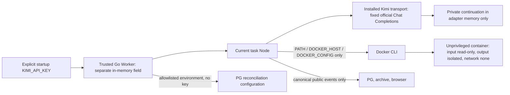

# C-LWEB122-01 boundary review material (Builder candidate)

This is input to independent review, not a Verdict. If the Regulator uses the same
model family, the contract requires the bounded Human H-LWEB122-BOUNDARY pass/problem
**after** technical review; it did not require a new Builder pre-live approval.

- Credential is absent from API/PG/Redis environment, persisted reconciliation env,
  Docker child env and container env/mounts. Key value is never accepted from HTTP,
  a report, a model tool call or a checkpoint. Config/parser rejects endpoint and
  model/profile overrides; installed transport fixes official URL.
- Synthetic marker probes use installed Kimi parsing with fake transport, real
  Native loop and actual Docker. Private reasoning returns only in the adapter's
  next in-memory request; recursive output/archive checks find neither private
  marker nor credential. Raw error bodies are also excluded. See offline hashes.
- Allowed outbound data: exact question; same-conversation completed public answer;
  fixed report/manifest schema and necessary model-selected computed snippets;
  canonical public tool feedback. No old private logs, unrelated files, credential
  stores, reasoning checkpoints or raw wire bodies are read/sent.
- Live checkpoint versions 1/2 reject before any send; actual owned interrupted
  live task also returns HTTP409 unsupported. Different-account task/bundle/history
  reads fail. Post-restart history, files and total send count are unchanged.
- Execution completion, artifact structure/reference validity, and answer semantics
  are separate. The validator supplies feedback inside the same model loop; it
  does not fill correct counts or manufacture a successful answer.

Private sources: `evidence/node-offline07.log`, `node-offline08.log`,
`node-failures02.log`, `isolation.log`, `go-race03.log`, `readback/checks.json`,
actual attempt public traces and installed package manifests. Exact hashes and the
full final candidate SHA are in the final evidence index/Handoff.
