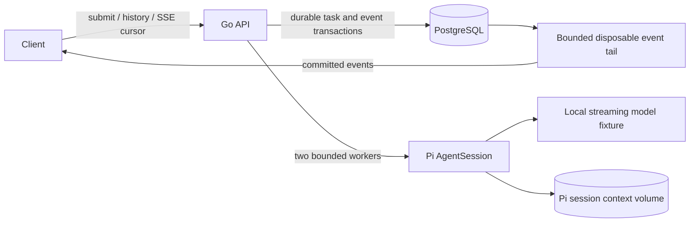

# Pi service experiment (#142)

A server-only Go API and PostgreSQL control plane around **actual upstream Pi 1.3.0**. The default model is a deterministic local HTTP fixture, not an LLM. No tools, GPU, Redis, frontend or paid API call is needed. This is an isolated single-owner development service, not a public multi-user platform.



## Run

Run these commands on a **Linux server** with Docker Engine/Compose, Go 1.24+, Node 22.19+ and npm (measured on Linux amd64). The host-built Go executables and mounted Node distribution must match the Linux container architecture; native macOS binaries cannot be mounted as substitutes. On the measured server, `scripts/build-owned.sh` also supports a network-disabled 1 CPU/1 GiB build container using existing `GO_ROOT` and `GO_CACHE_ROOT`. Use an existing user-space toolchain on PATH; no global installation or server coding-agent login is needed.

```sh
cd platform/pi-service
./scripts/build.sh
export NODE_ROOT="$(dirname "$(dirname "$(command -v node)")")"
export EVIDENCE_ROOT="$PWD/scratch/evidence"
mkdir -p "$EVIDENCE_ROOT"
docker compose up -d pg pi api
curl --noproxy '*' http://127.0.0.1:18142/health
python3 scripts/smoke.py
```

`NODE_ROOT` must be the actual Node installation directory containing `bin/node`, not a symlink shim directory. Source and Node are mounted read-only. Compose publishes API 18142 and executor diagnostics 18143 on loopback only. PostgreSQL has no host port. The known database password is only a disposable isolated-stack credential, never an external credential. Keep this stack private.

```sh
curl --noproxy '*' -H 'Content-Type: application/json' \
  -d '{"key":"example-1","prompt":"Hello"}' \
  http://127.0.0.1:18142/sessions/example/tasks
curl --noproxy '*' -N http://127.0.0.1:18142/sessions/example/events
curl --noproxy '*' http://127.0.0.1:18142/sessions/example/tasks
# Reconnect after the last processed event ID:
curl --noproxy '*' -N -H 'Last-Event-ID: 3' http://127.0.0.1:18142/sessions/example/events
```

Use a new key for a new turn in the same session; duplicate key+same prompt returns the original task, changed prompt returns409. Session/key identifiers are 1–64 ASCII letters/digits/underscore/hyphen. Prompt <=8192 bytes, request <=16384 bytes. At most128 queued tasks globally,128 accepted tasks per session,2 active Pi executions,11000 SSE subscribers. Session exhaustion or uncertain prior execution returns429; create a new session for further work. This bound is intentional for the experiment, not a pagination substitute claimed as production-ready history.

## State and recovery

PostgreSQL owns accepted task identity, status and ordered committed events. Pi `SessionManager` files in `pi-data` own finalized model context. They are not a second control-plane event store. Completed-session follow-up restores Pi context; HTTP history reads PostgreSQL. Pi and PostgreSQL do not share a transaction. If execution is interrupted or its result cannot be durably established, the task becomes `interrupted`, queued same-session tasks become `cancelled`, and that session is blocked. No automatic model resend or claim of exactly-once model execution. Retain both volumes when investigating ambiguity.

A PostgreSQL advisory connection lock restricts control-plane execution to one service instance. Startup recovery marks former running work uncertain; lost lock connection shuts the service down. A reserved4-connection control pool (including singleton ownership) is separate from an8-connection event-read pool. Terminal status/event writes are atomic and idempotent; three bounded state-only persistence attempts are allowed, then unresolved persistence stops the service for explicit recovery. No model request is repeated. Claims serialize a session; different sessions can use the two workers. Per-session workspaces/config/context paths are explicit. All Pi tools, ambient extensions, MCP, skills, context-file discovery, compaction and model retry are disabled. The normal model protocol adapter remains upstream Pi; `pi/model.mjs` is only a labelled streaming endpoint fixture.

SSE delivery is at-least-once across reconnects. Consumers persist their last processed ID and deduplicate IDs. IDs are globally ordered committed event identities, so numeric gaps from other sessions are normal. SSE notification buffers hold one hint; data are replayed from committed state. A disposable shared tail caches at most128 subscribed sessions,256 events/64KiB each; older cursors fall back to SQL. Cache misses and invalidation never create authoritative events. Set `SSE_TAIL_CACHE=0` in the API environment for the unoptimized per-subscriber SQL baseline. Slow writes have a5s deadline, disconnect, and can reconnect with a cursor. HTTP disconnect does not cancel durable tasks.

## Verify and stop

```sh
go test -race ./...
python3 scripts/smoke.py
# Only this owned Compose project's API is killed/restarted:
python3 scripts/restart-probe.py
python3 scripts/slow-consumer.py
python3 scripts/terminal-failure.py
export SOURCE_SHA="$(git rev-parse HEAD)"
./scripts/run-load.sh 100 1  # then1000/10000, repetitions1–3
./scripts/run-load.sh 10000 1 100  # optional100 sessions ×100 subscribers
# Stop the owned stack; preserve database/context volumes:
docker compose down
```

`internal/store` integration test requires a dedicated empty test database via `TEST_DATABASE_URL`; without it the test explicitly skips. Never point it at the development history database. The evidence report records the actual PostgreSQL-backed run separately from unit checks.

Resource envelope includes the load generator: PG1CPU/1GiB, API1CPU/2GiB, Pi+synthetic model1CPU/4GiB, load1CPU/1GiB. Container nofile32768, no global kernel/daemon changes. Load scripts require20GiB free disk. Inspect host pressure and stop owned loads if it becomes material. Scripts are foreground/bounded, not a permanent deployment supervisor.

## Measurements and boundaries

C10K means verified simultaneous SSE connections exchanging heartbeats/events, **not**10000 active models. The hot-session workload has one conversation with many subscribers and two maximum executors; a sharded comparison is separately labelled. Target hold120s with timer/scheduling tolerance, fixed synthetic prompt, open-loop one task offer every5s after the paced connection ramp, seeded identities, three repetitions per reached level. Full raw receipts retain reconnects, event IDs, errors and sample counts. Percentiles use nearest-rank on observed completion polling latency (100ms polling included), not model inference latency. Same-host generator interference is part of the reported resource envelope. Redis and public deployment are out of scope.

See [upstream attribution](UPSTREAM.md) and [experiment evidence](../../docs/evidence/pi-service/README.md).
